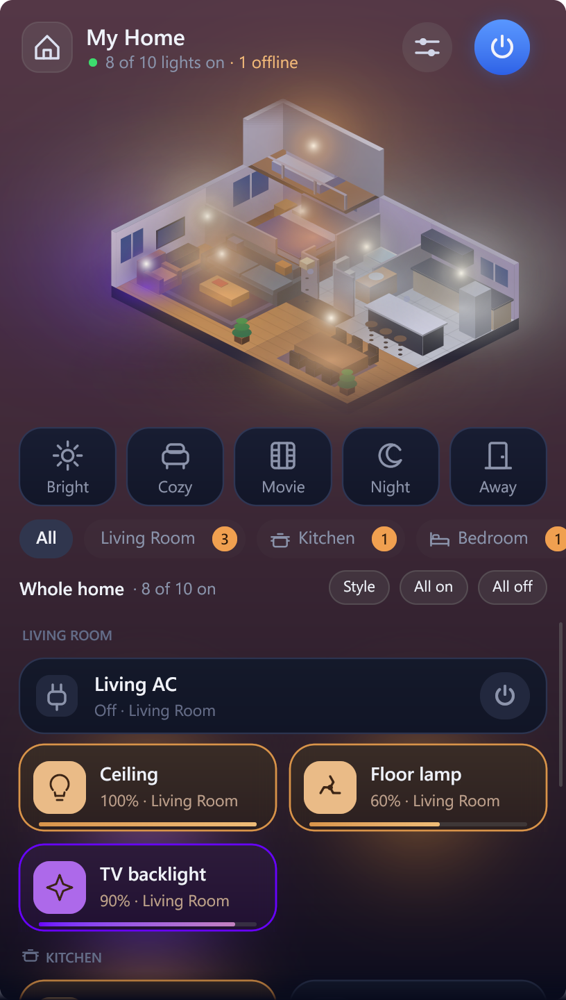
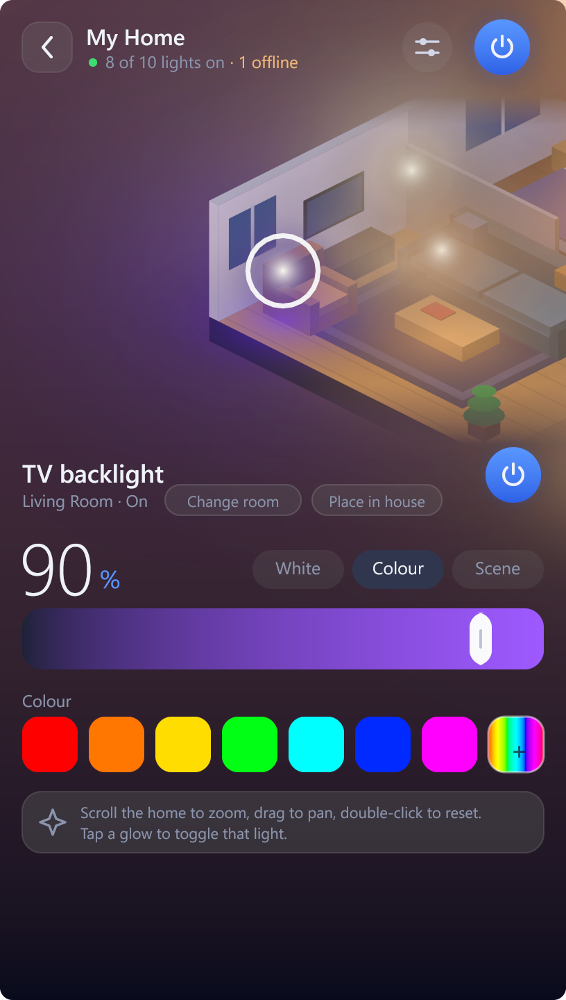

# Tray panel for controlling Tuya lights and plugs on Windows

A small native Windows tray app that lists the lights and plugs in a Tuya account and controls them over the local network. Click the tray icon, get a flyout with scenes, rooms, per-light brightness, colour temperature and colour.




## What is different

- Local control first: devices are driven over the LAN (Tuya protocol 3.3), with the Tuya cloud used only as a fallback when a device cannot be reached.
- No Tuya IoT developer account or paid cloud project. Linking uses the same User Code and QR approval flow that Home Assistant's Tuya integration uses.
- Pure Go and Gio. One executable of about 15 MB, no web view, no runtime, no CGO. About 40 MB of RAM while the panel is open and under 1 MB once it is hidden, because the working set is trimmed on hide.
- Optional isometric home view that places lights by room and name. Scroll to zoom, drag to pan, double-click to reset, and place any light by hand.
- Rooms can be reassigned locally, because the Tuya sharing API cannot change them. Overrides are stored in settings and exposed through the API.
- Per-light brightness, colour temperature, preset colours and a custom hue and saturation picker.
- Scenes (Bright, Cozy, Movie, Night) adjust only the lights that are already on; Away turns everything off.
- Per-light effects like the Tuya app's Scene tab: Night, Reading, Cocktail, Leisure, Soft, Blinking, Rainbow, Rave and Nature, sent as the same scene data the Tuya app uses (captured from real bulbs; models that use other scene formats may differ).
- A loft appears in the home view when a light is assigned to it by room or name (loft, attic, upstairs) or placed there by hand.
- The tray menu has Refresh devices, which reloads rooms and names from Tuya and rescans the LAN.
- Schedules and a sleep timer: switch lights, rooms or everything on or off, dim, or run a scene or effect at a set time on chosen days. Times show in 12-hour format by default, with a setting for 24-hour.
- Light show: sync chosen lights to the colours of a screen area, or to the sound playing on the PC (system audio loopback, not the microphone). It talks to the bulbs over the LAN only, so bulbs without a LAN address are skipped. Stop it from the panel or the tray menu.
- Icons: give any light, plug or room one of 16 built-in icons or your own image. Chosen images are cropped square, shrunk to 96 px and copied into `%APPDATA%\TuyaTray\icons`, so the original file is not needed afterwards.
- Home design: the home view is drawn from a JSON plan. Pick Apartment, Studio or Cottage in Settings, or save your own as `house.json` in the settings folder (the web panel has an editor and the schema is validated on save).

## Use

1. Run `TuyaTray.exe` and click the tray icon.
2. In the Tuya app open Me, the gear icon, Account and Security, and note the User Code. The panel shows these steps.
3. Enter the code in the panel, press Show QR, and scan the QR code with the Tuya app.

The linked session and device keys are stored encrypted with Windows DPAPI under `%APPDATA%\TuyaTray`. Nothing is sent anywhere except to Tuya (login, device list, fallback commands) and to your devices on the LAN.

## Local API

Off by default. In the panel open Settings, then Local API. Turning it on asks for confirmation, because the API uses plain HTTP. Swagger UI is served at `http://127.0.0.1:7480/swagger/` and the REST API exposes the same operations as the panel: devices, brightness, temperature, colour, rooms, scenes, rescan and account linking.

- Port: configurable, 7480 by default.
- Access: only loopback addresses are accepted. Other machines must be listed explicitly as IPs or CIDR ranges.
- Sign-in: optional HTTP Basic username and password. The password is stored as a salted hash.

The same options live in `%APPDATA%\TuyaTray\settings.json` as `local_api`, `api_port`, `api_allow`, `api_auth` and `api_user`.

The API can switch every light and plug in the home, and it has no TLS. If you add another machine to the allowlist, turn on the username and password as well, and only do it on a network you trust. Basic auth over plain HTTP can be read by anyone on the same network.

## Web panel

With the local API enabled, `http://127.0.0.1:7480/` serves a browser version of the panel that uses the same endpoints: home view with zoom, pan and placement, scenes, rooms, drag-to-dim tiles, brightness, temperature and colour. The layout adapts to the browser: a two-column desktop view with a sticky house, a tablet grid, and a single-column phone view. It follows the same allowlist and sign-in settings, so reaching it from another device on your LAN needs that device's address in `api_allow`.

## Build

Requires Go 1.26 or newer on Windows.

```
go build -trimpath -ldflags "-s -w -H=windowsgui" -o bin/TuyaTray.exe .
```

UPX shrinks the file to about 4 MB but makes Windows keep the whole decompressed image in private memory, adding roughly 50 MB of RAM, so the build is left unpacked.

`TuyaTray.exe -shot <folder>` renders the demo screens to PNG without opening a window.

The exe icon comes from `TuyaTray_windows_amd64.syso`, compiled from `TuyaTray.rc` and `assets/icon.ico`, and Go links it automatically.

## Caveats

- LAN control covers protocol 3.1 and 3.3. Devices on 3.4 or 3.5 are controlled through the cloud.
- The login uses Home Assistant's public client ID, so Tuya could restrict it. See [PROTOCOL.md](docs/PROTOCOL.md).
- Rounded window corners and the dark frame come from Windows 11; Windows 10 shows square corners.
- Lights are matched to home view slots by room first, then by name keywords; use Place in house in a light's detail view to override.

## Documentation

[PROTOCOL.md](docs/PROTOCOL.md) records the LAN protocol, discovery, data point maps and the account login flow as implemented here.
